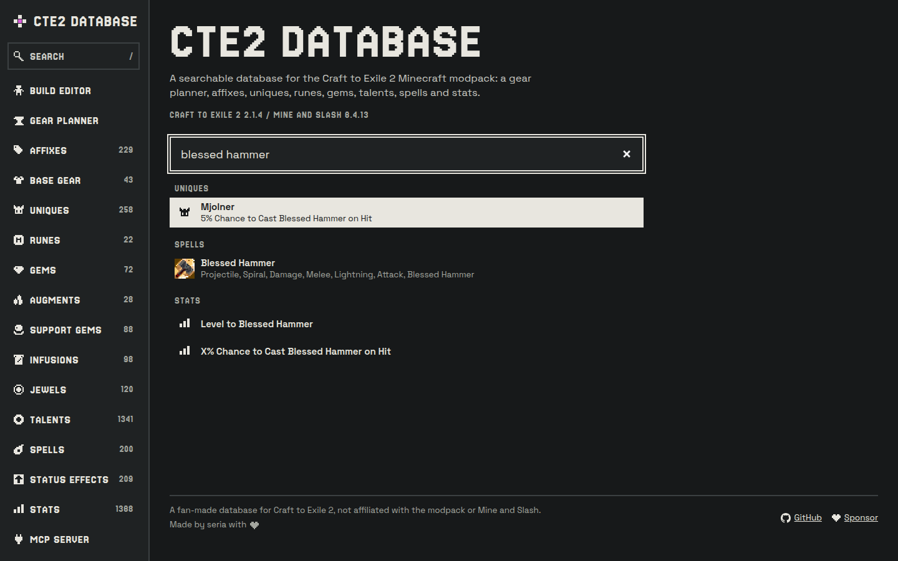
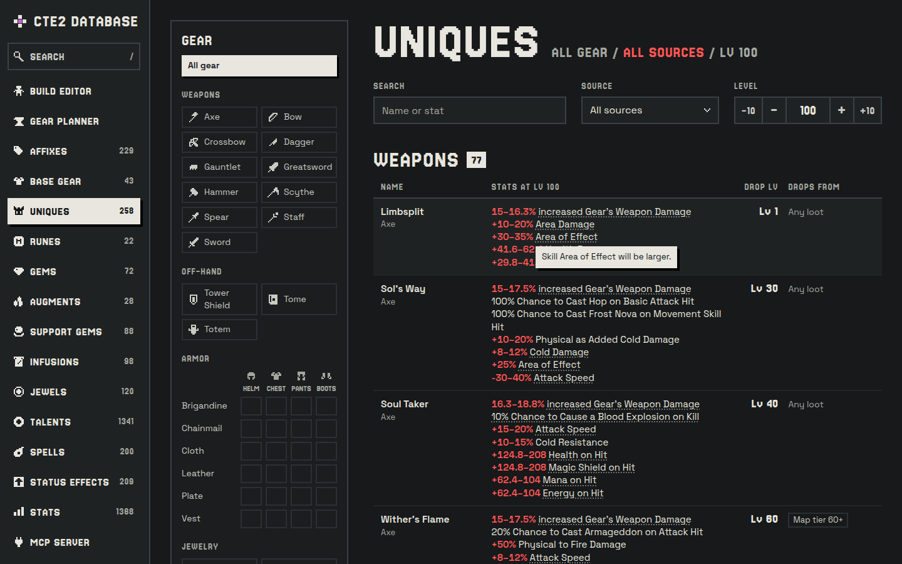
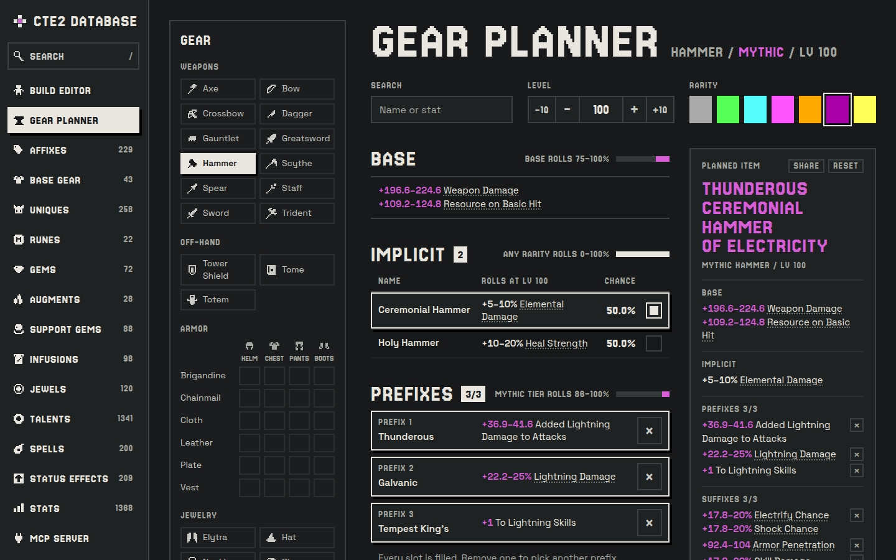
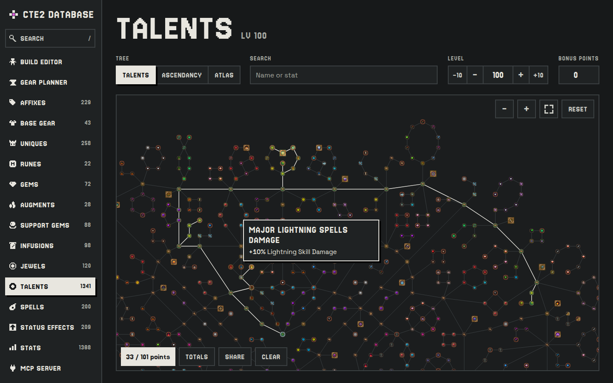
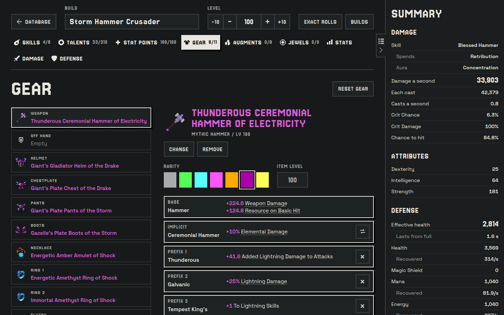
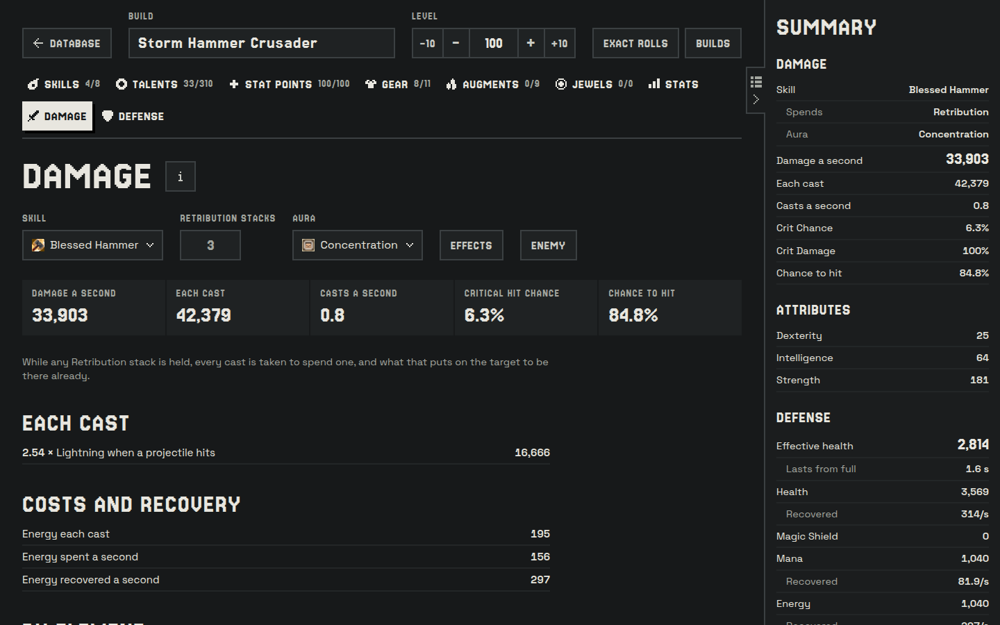
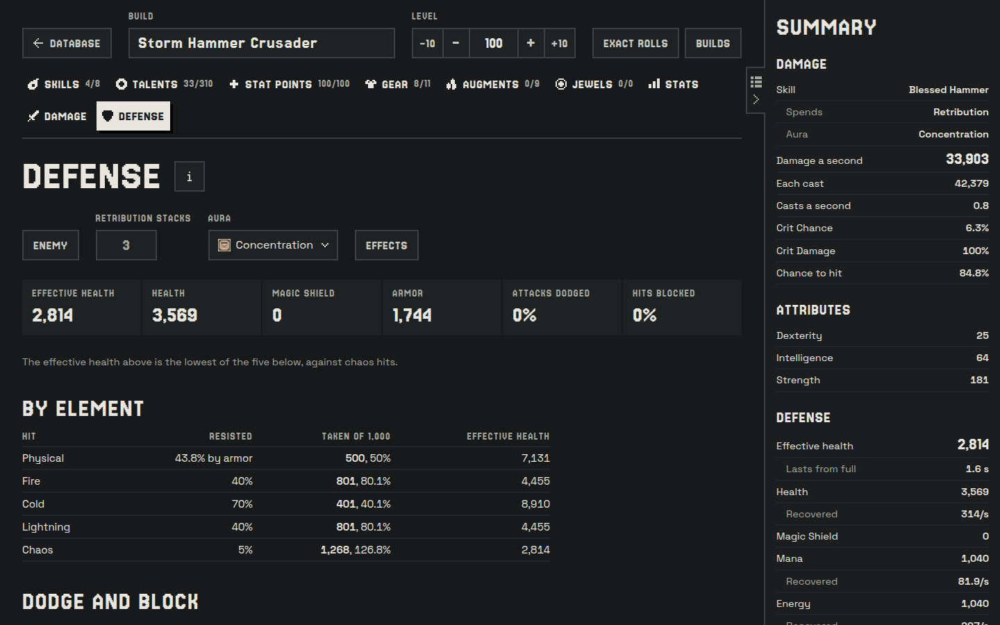

# cte2-db

Fan-made database site for the Minecraft modpack [Craft to Exile 2](https://www.curseforge.com/minecraft/modpacks/craft-to-exile-2).

Visit [cte2.seria.moe](https://cte2.seria.moe) to see it.

This project is not affiliated with the CTE2 and Mine and Slash mod team.

All site data and assets are extracted from the modpack.

## Screenshots

### Search

### Database pages

### Gear planner

### Talent trees

### Build editor

## MCP server

AI clients can query the database through an [MCP](https://modelcontextprotocol.io) server at `https://cte2.seria.moe/mcp`.

It runs as a Cloudflare Pages Function (`functions/mcp.ts`). To try it locally, run `bun run build` and then `bunx wrangler pages dev dist`, and connect to `http://localhost:8788/mcp`.